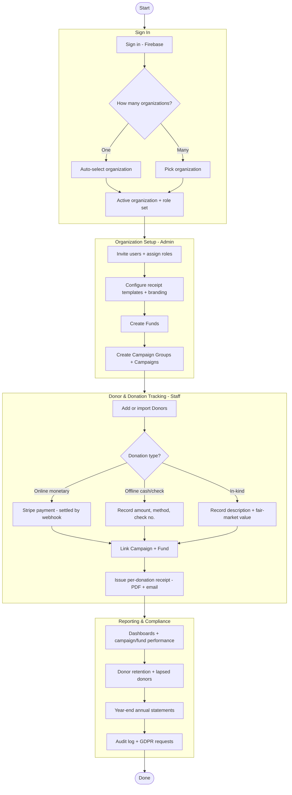

# Portfolio Demo - Donor Tracking
This app is a multi-tenant system for nonprofit organizations to track **donors**, record **donations**, and organize giving into **campaigns** and **funds**. It also covers the back-office work around giving: reporting, tax receipts, online payments, bulk CSV import/export, and audit/compliance.

Each customer nonprofit is an **Organization** (tenant). All organizations share one database, and every record is tagged with its organization's `tenantId` so each organization only sees its own data.

**Admins**, **Staff**, and **Viewers** are internal users of an organization. A user can belong to several organizations and holds a role in each one. Donors do not log in.

## Running the demo
The demo is a client-only Vite + React + TypeScript app. All data is seeded in the
browser by an in-memory mock API, so no backend is required.

```bash
npm install     # install dependencies
npm run dev     # start the dev server (http://localhost:5173)
npm run build   # type-check and build for production
npm run test    # run the Vitest suite
npm run lint    # run ESLint
```

The demo signs you in as **Jordan Rivera**, who belongs to three organizations with a
different role in each:

| Organization | Role |
| --- | --- |
| Hope Foundation | Admin |
| City Arts Collective | Staff |
| Green Earth Trust | Viewer |

Use the **organization switcher** in the top bar to change the active organization and
see how the navigation changes by role. Data is held in memory, so reloading the page
restores the seeded state. The end-to-end process is summarized in the
[Workflow](#workflow) section below.

### Demo scope
The demo implements the **Dashboard**, **Donors**, **Donations**, **Campaigns**,
**Funds**, and **Receipts** screens, including dialogs to add donors, donations,
campaigns, and funds. **Reports**, **Import / Export**, **Audit Log**, **Org Settings**,
**Users**, and the annual receipt batch appear in the navigation as placeholders for
features that are designed but not yet built.

### Running with Docker
The `Dockerfile` builds the static bundle and serves it with nginx on port `6069`.

```bash
docker build -t donor-tracking-demo .
docker run -p 6069:6069 donor-tracking-demo   # http://localhost:6069
```

## Design Documentation
The full high-level design lives in [design-docs/](design-docs/README.md).

| # | Document | Purpose |
| --- | --- | --- |
| 00 | [Overview](design-docs/00-overview.md) | Goals, scope, personas, context diagram, glossary |
| 01 | [Architecture](design-docs/01-architecture.md) | Logical & deployment architecture, tech stack, component view |
| 02 | [Data Model](design-docs/02-data-model.md) | Entities, relationships (ERD), MongoDB collection shapes |
| 03 | [Multi-Tenancy & Security](design-docs/03-multitenancy-security.md) | Tenant isolation, RBAC, field-level access, PII/GDPR |
| 04 | [Features](design-docs/04-features.md) | Reporting, receipts, payments, import/export, audit |
| 05 | [API Design](design-docs/05-api-design.md) | REST resources, auth, tenant scoping, error model |
| 06 | [Mock Backend Strategy](design-docs/06-mock-strategy.md) | How the demo simulates the backend in-browser |
| 07 | [UI & Information Architecture](design-docs/07-ui-ia.md) | Routes, screens, component structure, navigation |
| 08 | [Roadmap & Decisions](design-docs/08-roadmap-decisions.md) | Phasing, deferred items, key decisions (ADRs) |

## The Production Application
For descriptive purposes only. This README outlines the workflow and technology used for the Production application. The demo application replaces the backend with an in-browser mock API and uses a simplified, client only UI.

# Technology
## Frontend Technology
The Frontend is a single-page app built with React 19 and TypeScript using Vite. The UI uses Material UI components, with MUI X Charts for dashboards. Routing uses React Router with nested layouts per feature area. Server state, caching, and optimistic updates use TanStack Query.

All API calls go through a typed API client. An environment variable (`VITE_API_MODE`) switches the client between a **mock** transport and a live **HTTP** transport, so components and hooks are identical in the demo and in production.

The UI follows a Container-Presentational pattern. Route components load data through feature hooks and pass it to shared presentational components such as data tables, KPI cards, chart wrappers, and a reusable `SensitiveField` that handles masking and audited reveal of PII.

### Frontend Tech List
- Vite
- React
- TypeScript
- React Router
- Tanstack Query
- Material UI components
- MUI X Charts

## Backend Technology
The backend is an ASP.NET Core minimal API in C#. It is stateless and runs in containers that scale horizontally behind a load balancer. Firebase Authentication is the identity provider; the API validates Firebase ID tokens and resolves the user's role from their membership in the active organization.

Data is stored in MongoDB using pooled multi-tenancy: one shared database and shared collections, with every document tagged by `tenantId`. A single data-access layer injects the tenant filter into every query and fails closed if it is missing.

Online donations are processed with Stripe, with signed, idempotent webhooks as the source of truth for settlement. Tax receipts are rendered as PDFs on the server, stored in object storage, and emailed to donors through SendGrid.

### Backend Tech List
- .NET
- ASP.NET Core minimal API
- MongoDB
- Firebase Authentication
- Stripe
- SendGrid
- Server-side PDF rendering (e.g. QuestPDF)
- Azure Blob Storage / S3

# Roles
The application has three roles: **Admin**, **Staff**, and **Viewer**. All users are internal to an organization. A user's role is set per organization, so the same person can be an Admin in one organization and a Viewer in another.

## Admin
**Admins** (for example, a Development Director) configure and manage the organization. They manage users and roles, receipt templates and branding, and funds. They handle refunds, GDPR export and erasure requests, and review the audit log. Admins can see all sensitive donor data.

## Staff
**Staff** (for example, Gift Officers and Bookkeepers) do the day-to-day work. They add and edit donors and donations, run campaigns, issue tax receipts, and import or export data in bulk. Sensitive donor fields are masked for Staff, who can reveal a value when needed; every reveal is recorded in the audit log.

## Viewer
**Viewers** (for example, Board Members and Analysts) have read-only access to dashboards and reports and can export summaries. Sensitive donor fields are never shown to Viewers.

# Access and Security
Each organization can only see its own data. The active organization is sent with every API request, and the API only honors it after confirming the user has an active membership in that organization. The user's role always comes from that membership on the server, never from the client.

| Capability | Admin | Staff | Viewer |
| --- | :---: | :---: | :---: |
| View dashboards & reports | ✅ | ✅ | ✅ |
| Export CSV/reports | ✅ | ✅ | Summary only |
| Create/edit donors & donations | ✅ | ✅ | ❌ |
| Delete / void / refund | ✅ | Request | ❌ |
| Issue receipts | ✅ | ✅ | ❌ |
| Configure org, templates, funds | ✅ | ❌ | ❌ |
| Manage users & roles | ✅ | ❌ | ❌ |
| Bulk import | ✅ | Limited | ❌ |
| Reveal sensitive PII fields | ✅ | Reveal with audit | ❌ |
| Handle GDPR erase/export | ✅ | ❌ | ❌ |

Sensitive fields, such as a donor's tax ID or bank and check references, are masked or removed by role on the server before data leaves the API. Sensitive fields are encrypted at rest and all traffic uses TLS.

Every sensitive view, export, and change is written to an append-only audit log. Donor consent is tracked, and GDPR requests are supported: **export** produces a full data package for a donor, and **erase** redacts personal data while keeping de-identified financial records for tax purposes.

Role checks in the UI only hide navigation and actions. The API is the real security boundary.

# Workflow
## Overview
The diagram below shows the end-to-end process: signing in and choosing an
organization, setting up campaigns and funds, recording donors and donations, and
issuing receipts and reports. See the
[UI & Information Architecture design doc](design-docs/07-ui-ia.md) for detailed
screen flows and the [Features design doc](design-docs/04-features.md) for receipts,
payments, and import/export.



## Sign In - All Users
1. Sign in with Firebase Authentication
2. Select the active organization
    - Skipped when the user belongs to only one organization
3. Switch organizations at any time from the top bar
    - All data and the user's role change to match the selected organization

## Organization Setup - Admin
1. Invite users and assign roles
2. Configure receipt templates and branding
    - Logo, header/footer, legal disclaimer, reply-to address
3. Create Funds (Ex. Scholarship Fund)
    - Mark restricted funds
4. Create Campaign Groups (Ex. 2026 Annual Appeal)
5. Create Campaigns
    - Name and description
    - Optional Campaign Group
    - Goal and start/end dates
    - Status (draft or active)

## Donor and Donation Tracking - Staff
1. Add Donors
    - Individual or organization
    - Contact info and addresses
    - Consent and GDPR basis
    - Optional sensitive fields
    - Review possible duplicates before saving
2. Bulk import Donors or Donations from CSV
    - Map columns, validate, preview errors, commit valid rows
3. Record Donations
    - Online monetary gifts are paid through Stripe
    - Offline cash/check gifts record the method and check number
    - In-kind gifts record a description and fair-market value
    - Optionally link a Campaign and Fund
4. Issue receipts
    - Per-donation receipt generated as a PDF and emailed to the donor

## Reporting and Compliance
### Viewer
1. Review the overview dashboard
    - Year-to-date totals, giving trend, top donors, recent gifts
2. Review reports
    - Campaign and fund performance against goals
    - Donor retention and lapsed donors
3. Export summary reports

### Admin
1. Run year-end annual statements for each donor
2. Process refunds
3. Review the audit log
4. Handle GDPR export and erasure requests
